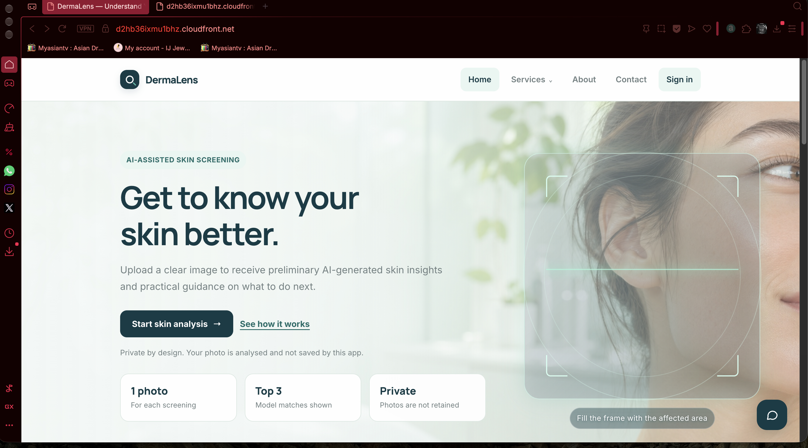
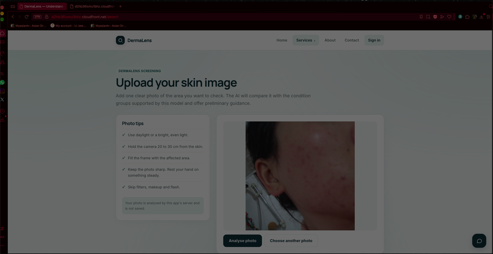
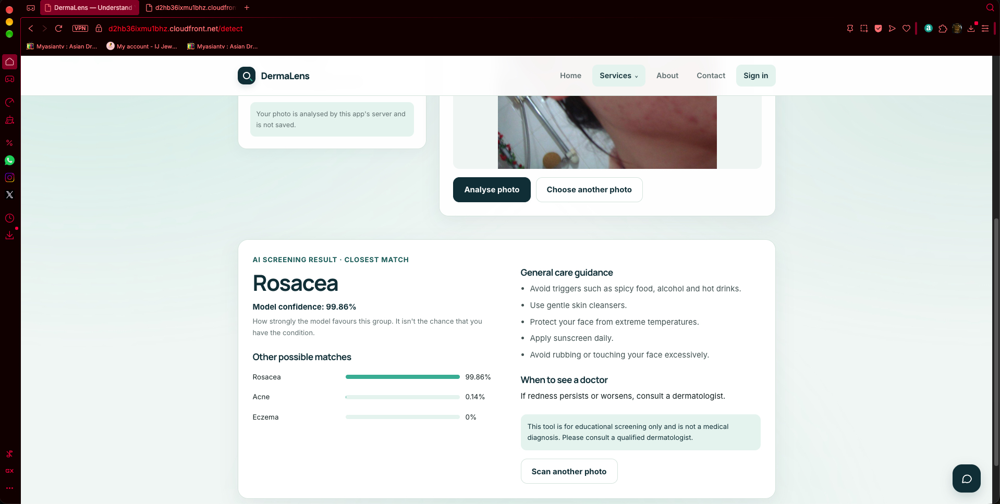
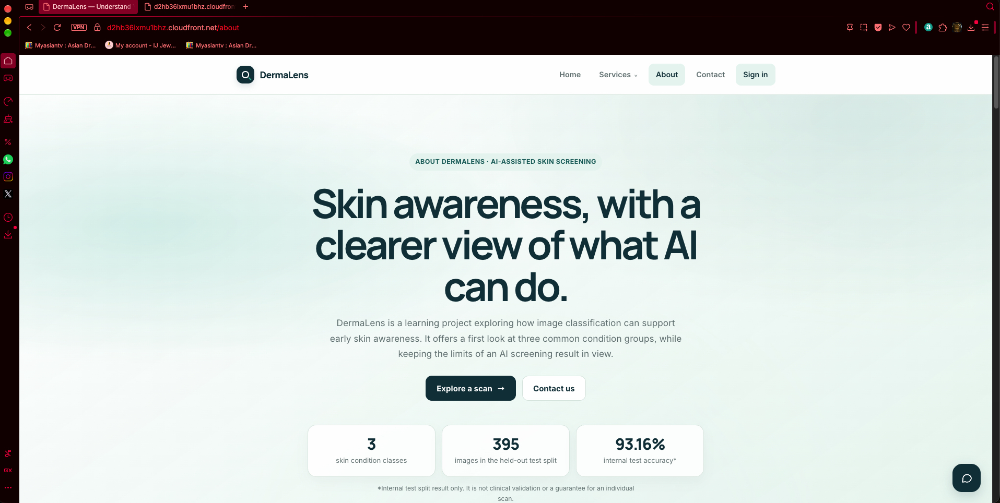
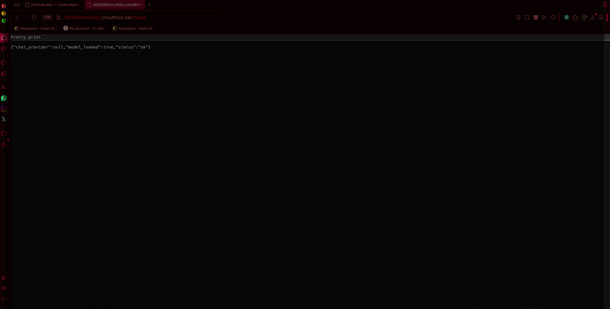
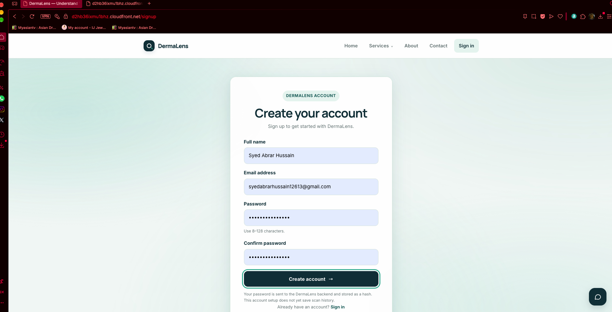
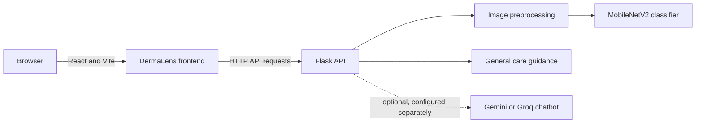

<p align="center">
  
</p>

<h1 align="center">DermaLens — AI Skin Screening</h1>

<p align="center">
  An educational skin image screening prototype built with React, Flask, and TensorFlow.
</p>

<p align="center">
  
  
  
  
  
</p>

## Project introduction

DermaLens lets a user upload or capture a skin image and receive a preliminary model result for acne, eczema, or rosacea, along with general care guidance. The project pairs a React/Vite frontend with a Flask API and a TensorFlow/Keras image classifier using MobileNetV2 transfer learning.

The separate [AWS Terraform repository](https://github.com/syedabrar-dev/rosacea-app-aws-terraform) contains the cloud deployment infrastructure for this application.

## Live demo and video demonstration

- **Live demo:** [Open DermaLens](https://d2hb36ixmu1bhz.cloudfront.net) — the URL used for the deployed demo; it may be offline if the AWS resources have been removed.
- **Video walkthrough:** [Watch the DermaLens walkthrough](docs/dermalens-demo.mp4)

## Application screenshots

<table>
  <tr>
    <td align="center"><br /><sub>Home page</sub></td>
    <td align="center"><br /><sub>Image upload and photo guidance</sub></td>
  </tr>
  <tr>
    <td align="center"><br /><sub>Screening result and care guidance</sub></td>
    <td align="center"><br /><sub>About DermaLens</sub></td>
  </tr>
  <tr>
    <td align="center"><br /><sub>API health check</sub></td>
    <td align="center"><br /><sub>Account sign-up</sub></td>
  </tr>
</table>

## Features

- Upload an image or capture one with a supported device camera.
- Show the closest model match and the model's confidence scores for the supported classes.
- Present general care information and guidance on when to contact a clinician.
- Provide account sign-up and sign-in routes.
- Offer an optional chatbot endpoint that can use Gemini or Groq when configured with an API key.
- Expose a health endpoint to report API status and whether the model loaded.

## System architecture



The frontend sends screening requests to the Flask API. The API prepares the image, runs inference with the bundled model, and returns the model scores and supporting guidance. The optional chatbot requires a configured provider key.

## Technology stack

| Area | Technologies |
| --- | --- |
| Frontend | React 18, Vite, JavaScript, React Router |
| API | Python, Flask, Flask-CORS, Flask-SQLAlchemy |
| Image model | TensorFlow/Keras, MobileNetV2, Pillow, NumPy |
| Evaluation | scikit-learn |
| Optional chatbot | Gemini or Groq API |
| Local development | Python virtual environment, npm |

## Model performance and evaluation

The repository's evaluation report records **93.16% accuracy** on a held-out test set of **395 images**. Per-class results from [`backend/metrics.json`](backend/metrics.json):

| Class | Precision | Recall | F1 score | Test images |
| --- | ---: | ---: | ---: | ---: |
| Acne | 0.88 | 0.96 | 0.92 | 129 |
| Eczema | 0.99 | 0.97 | 0.98 | 126 |
| Rosacea | 0.93 | 0.87 | 0.90 | 140 |
| **Overall accuracy** |  |  | **93.16%** | **395** |

These are results for the reported dataset and test split. They are not evidence of clinical performance, and a model confidence score is not the probability that a person has a condition.

## Installation instructions

### Prerequisites

- Python 3.10 or 3.11
- Node.js and npm
- The model file and class labels are included in `backend/`.

### Start the Flask API

```bash
cd backend
python3.11 -m venv .venv
source .venv/bin/activate
pip install --upgrade pip
pip install -r requirements.txt
cp .env.example .env
# Set a new SECRET_KEY. Add a chatbot provider key only if you use that feature.
python app.py
```

### Start the frontend

In a second terminal from the repository root:

```bash
cd frontend
npm install
npm run dev
```

Open [http://localhost:5173](http://localhost:5173). Check [http://127.0.0.1:5000/health](http://127.0.0.1:5000/health) to confirm the API is running and the model loaded.

### Train the model (optional)

The included model can be used without training. To train again, provide your own dataset in the expected folder structure:

```text
data/
  train/
    Acne/
    Eczema/
    Rosacea/
```

Then run:

```bash
cd backend
python train_model.py --data ../data
```

The dataset is not included in this repository.

## Limitations and disclaimer

- DermaLens is an educational screening prototype. It is not a medical device, does not diagnose disease, and cannot replace a qualified clinician.
- The classifier covers acne, eczema, and rosacea only. Other skin conditions or differences in lighting, image quality, skin tone, and image framing can affect the result.
- The reported test metrics do not establish clinical validity or guarantee an individual result.
- The live AWS demo may stop working if its infrastructure is taken down. The application can still be run locally using the steps above.
- Do not commit `.env` files, provider API keys, passwords, or other credentials.
